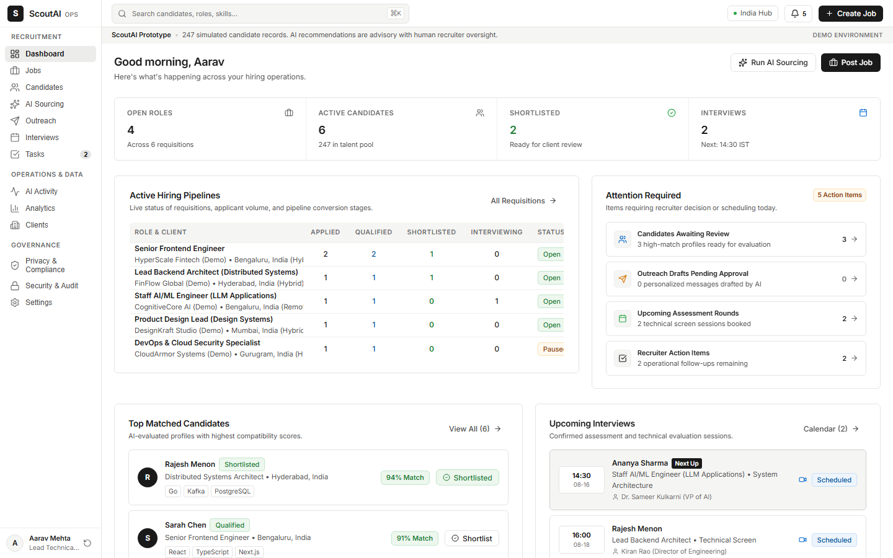
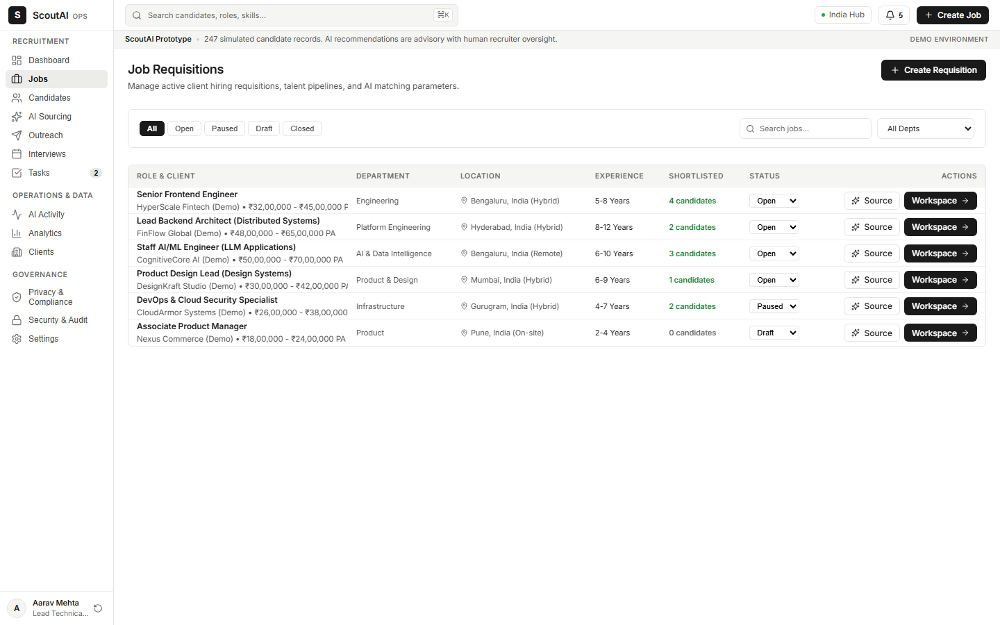
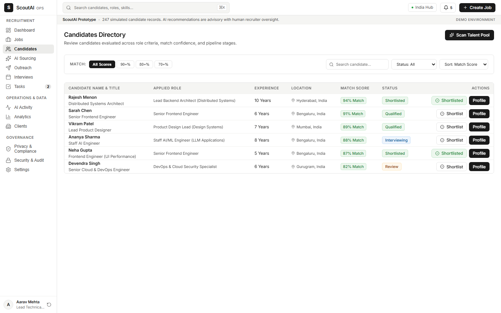
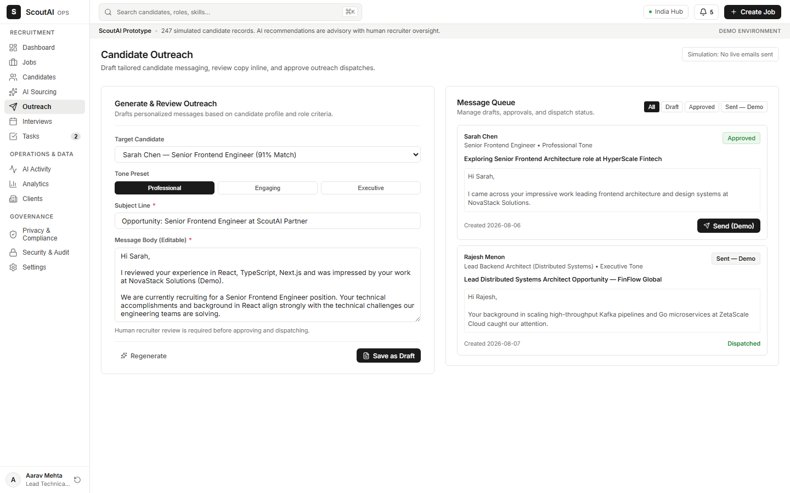
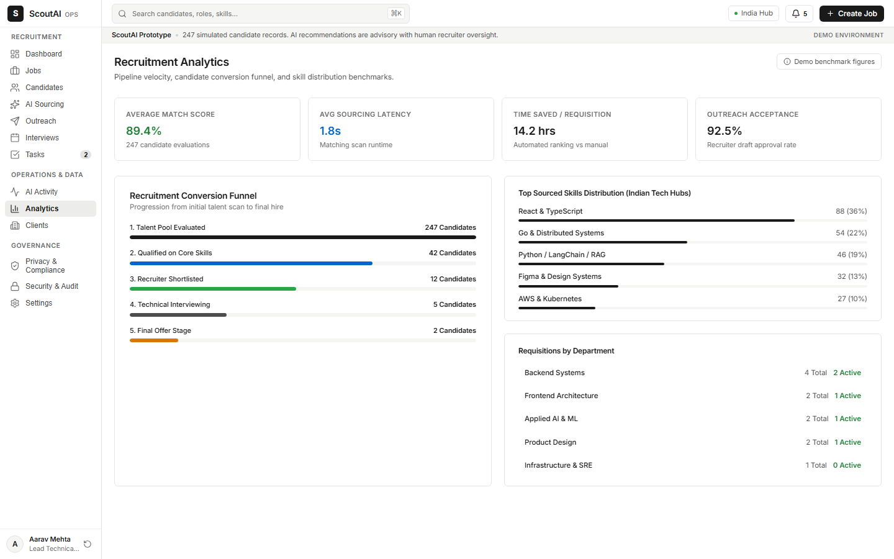
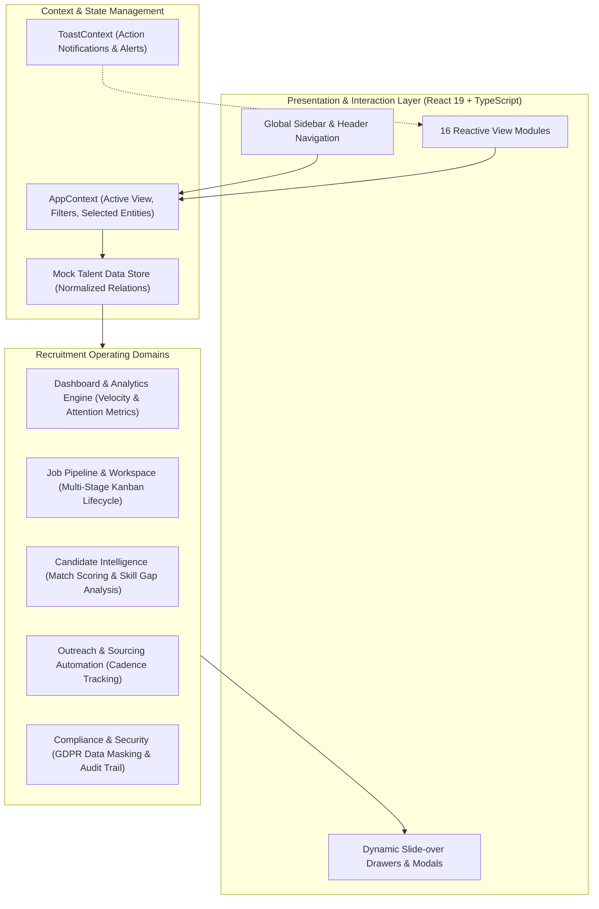

# ScoutAI — AI-Native Talent Intelligence Operating System

[](https://react.dev/)
[](https://www.typescriptlang.org/)
[](https://vitejs.dev/)
[]()
[](LICENSE)
[](https://k39139215-gif.github.io/scoutai/)

### 🌐 Live Interactive Application Preview
👉 **[Click Here to Open ScoutAI Live Interactive App](https://k39139215-gif.github.io/scoutai/)**

> **Enterprise Talent Intelligence & Recruitment Operating System** built for modern talent teams to manage multi-client hiring pipelines, compute real-time candidate match scores, and enforce GDPR-compliant recruitment governance.

---

## 🌟 Executive Summary

Traditional applicant tracking systems (ATS) are glorified relational databases that force recruiters into manual spreadsheet exports, fragmented email threads, and untracked candidate interactions. 

**ScoutAI** shifts recruitment from reactive record-keeping to **autonomous talent intelligence**. It couples an interactive multi-view workspace with automated candidate scoring algorithms, talent pipeline kanbans, multi-channel outreach management, and enterprise data privacy compliance.

---

## 🖼️ UI Screens & Platform Walkthrough

### 1. Executive Intelligence Dashboard
Real-time talent pipeline metrics, candidate attention queue, and AI autonomous screening stream.


### 2. Multi-Stage Hiring Pipeline & Job Workspace
Visual drag-and-drop Kanban lifecycle (`Sourced` &rarr; `Screened` &rarr; `Interview Loop` &rarr; `Offer` &rarr; `Hired`).


### 3. Candidate Intelligence & Match Scoring
Deep resume parsing, skills gap radar, and algorithmic qualification scoring.


### 4. Autonomous Sourcing & Outreach Cadence
Multi-channel automated outreach sequences with engagement and response tracking.


### 5. Talent Velocity Analytics & Conversion Funnel
Time-to-hire velocity tracking, drop-off analytics, and team efficiency metrics.


---

## 📐 System Architecture



---

## 🖥️ 16 Core Enterprise View Modules

The platform is architected around 16 decoupled view controllers:

| Category | View Module | Key Capabilities |
| :--- | :--- | :--- |
| **Executive & Intelligence** | `DashboardView` | Pipeline health metrics, attention-required items, upcoming interviews, AI activity stream. |
| | `AnalyticsView` | Time-to-hire velocity, sourcing channel conversion rates, team productivity. |
| | `AIActivityView` | Log of autonomous screening actions, auto-match triggers, and outreach follow-ups. |
| **Pipeline & Workspace** | `JobsView` | Active, draft, and closed role directory with department & seniority filters. |
| | `JobWorkspaceView` | Multi-stage kanban board (Sourced &rarr; Screened &rarr; Interview &rarr; Offer &rarr; Hired). |
| | `CreateJobView` | Role spec builder, required skill weighting, salary bounds, and candidate criteria. |
| **Talent Sourcing & Candidates** | `CandidatesView` | Master talent database with full-text search, experience filters, and quick triage. |
| | `CandidateDetailView` | Comprehensive profile: resume breakdown, match score breakdown, interview notes, outreach history. |
| | `SourcingView` | Automated inbound/outbound candidate discovery with talent pool segmentation. |
| | `OutreachView` | Multi-step email and LinkedIn cadence tracking with open/response analytics. |
| **Operations & Collaboration** | `InterviewsView` | Unified calendar view of upcoming screening calls, technical loops, and feedback forms. |
| | `TasksView` | Prioritized recruiter action items, offer approvals, and candidate follow-ups. |
| | `ClientsView` | External hiring manager directory and multi-tenant department assignments. |
| **Governance & System** | `PrivacyComplianceView`| GDPR "Right to be Forgotten" workflows, consent logging, and retention policies. |
| | `SecurityView` | Session logs, role-based access control (RBAC), and authentication audit logs. |
| | `SettingsView` | Workspace branding, integration settings, and notification preferences. |

---

## 🎨 Design System & Engineering Decisions

1. **Zero-Dependency CSS Architecture:**
   * Built with pure custom CSS tokens defined in `src/tokens.css` (semantic colors, spacing scale, typographic hierarchy, elevation shadows).
   * Eliminates the bundle bloat and design inconsistency of generic UI frameworks.

2. **Deterministic Component Primitives:**
   * Custom atomic components in `src/components/common/`: `AIMatchCard`, `Badge`, `Button`, `Drawer`, `Input`, `Modal`.
   * Accessible, keyboard-navigable slide-overs for seamless context-preserving deep dives.

3. **Sub-second Build Velocity:**
   * Powered by **Vite 8** and **TypeScript 5.8** with Oxlint rules.
   * Compiles and bundles production chunks in under 1.5 seconds.

---

## 🛠️ Tech Stack & Dependencies

* **Frontend Framework:** React 19 (`react`, `react-dom`)
* **Language:** TypeScript 5.8 (Strict type safety)
* **Build Tooling:** Vite 8.2
* **Icons:** Lucide React (`lucide-react`)
* **Linter:** Oxlint (`oxlint`)

---

## 🚀 Local Build & Preview

```bash
# Install dependencies
npm install

# Run development server
npm run dev

# Compile TypeScript & production bundle
npm run build

# Preview production build
npm run preview
```

---

## ⚖️ Intellectual Property & License

**Copyright (c) 2026 Kartik. All Rights Reserved.**

This repository and its source code are published for **viewing, evaluation, and portfolio demonstration purposes only**. No permission is granted to reproduce, distribute, modify, deploy, or commercially exploit this software. See the [LICENSE](LICENSE) file for complete legal terms.
